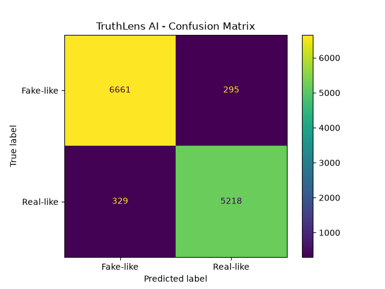
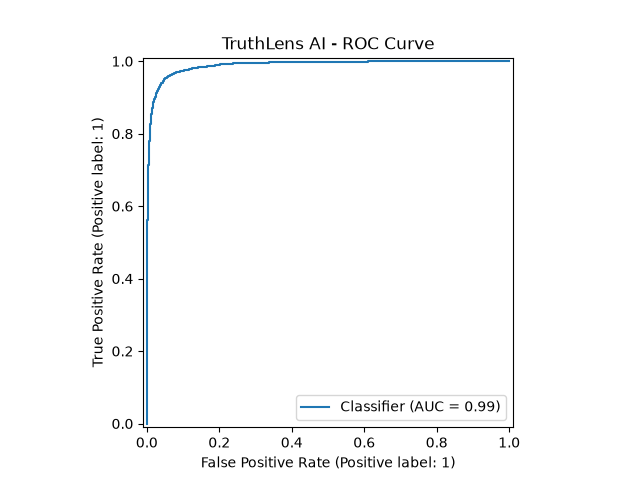
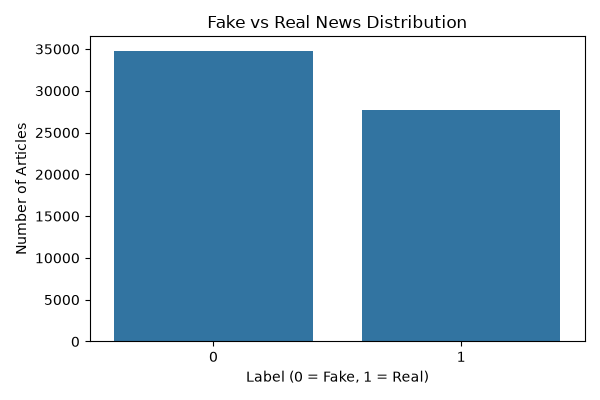
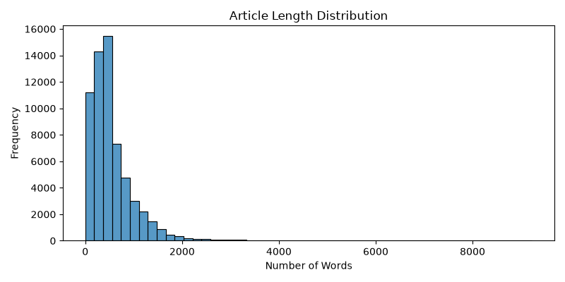

# 🔍 TruthLens AI
### Explainable Fake News Detection Using NLP and Machine Learning

[](https://truthlens-ai-ewdzctnpkf7pyvuywwbvj.streamlit.app/)
[](https://www.python.org/)

## 🌐 Live Demo

[Click here to use TruthLens AI](https://truthlens-ai-ewdzctnpkf7p7yvuwywbvj.streamlit.app/)

## 📌 About the Project
TruthLens AI is an interactive web application that uses Natural Language Processing (NLP) and Machine Learning to analyse news headlines and articles.

It predicts whether the entered text resembles fake-like or real-like news based on patterns learned from a labelled dataset. It also highlights influential words to help users understand the model's predictions.

## 🎯 Objectives
- Analyse news articles using NLP.
- Clean and preprocess textual data.
- Convert text into numerical features using TF-IDF.
- Train and compare machine-learning algorithms.
- Explain predictions using influential text features.
- Build and deploy an interactive web application.

## 🛠️ Technologies Used
- Python
- Pandas and NumPy
- Scikit-learn
- Natural Language Processing (NLP)
- TF-IDF
- Logistic Regression
- Multinomial Naive Bayes
- Linear Support Vector Machine (Linear SVM)
- Streamlit
- Joblib
- Matplotlib and Seaborn

## ⚙️ Project Workflow
1. Dataset collection
2. Data cleaning and preprocessing
3. Exploratory Data Analysis
4. TF-IDF feature extraction
5. Model training and comparison
6. Model evaluation
7. Explainable AI
8. Streamlit application development
9. Cloud deployment

## 🤖 Model Comparison

| Algorithm | Accuracy |
|---|---:|
| Logistic Regression | 94.56% |
| Multinomial Naive Bayes | 85.60% |
| Linear SVM | 95.01% |

**Best-performing model:** Linear SVM

## 📊 Model Evaluation

| Metric | Score |
|---|---:|
| Accuracy | 95.01% |
| Precision | 94.65% |
| Recall | 94.07% |
| F1 Score | 94.36% |
| ROC-AUC | 0.988 |

These scores were obtained on the held-out test split of the processed dataset.

### Confusion Matrix


### ROC Curve


### Dataset Visualisations




## 💡 Explainable AI
TruthLens AI identifies influential words that contribute to the model's prediction using feature contributions from the trained Linear SVM model.

## 📂 Project Structure

```text
TruthLens-AI/
├── app/
│   └── app.py
├── dataset/
├── models/
│   ├── best_model.joblib
│   └── tfidf_vectorizer.joblib
├── notebooks/
│   └── eda.py
├── screenshots/
├── src/
│   ├── fix_dataset.py
│   ├── inspect_dataset.py
│   ├── preprocess.py
│   ├── tfidf_features.py
│   ├── train_models.py
│   ├── explain_prediction.py
│   └── evaluate_model.py
├── README.md
├── requirements.txt
└── .gitignore
```

## 🚀 Run Locally

Clone the repository:

```bash
git clone https://github.com/vidyasherugar03/TruthLens-AI.git
cd TruthLens-AI
```

Install dependencies:

```bash
pip install -r requirements.txt
```

Run the application:

```bash
python -m streamlit run app/app.py
```

The trained model files must be available in the `models` directory.

## ⚠️ Disclaimer
This is an educational machine-learning project. Predictions are based on patterns learned from the dataset and do not independently verify whether a news article is factually true or false. Always consult reliable sources.

## 👩‍💻 Developer
Developed as an academic Data Science project to demonstrate practical skills in NLP, Machine Learning, Explainable AI and web application development.

## 🔗 Project Links

- 💻 GitHub Repository: [TruthLens AI](https://github.com/vidyasherugar03/TruthLens-AI)
- 🌐 Live Website: [Try TruthLens AI](https://truthlens-ai-ewdzctnpkf7p7yvuwywbvj.streamlit.app/)
